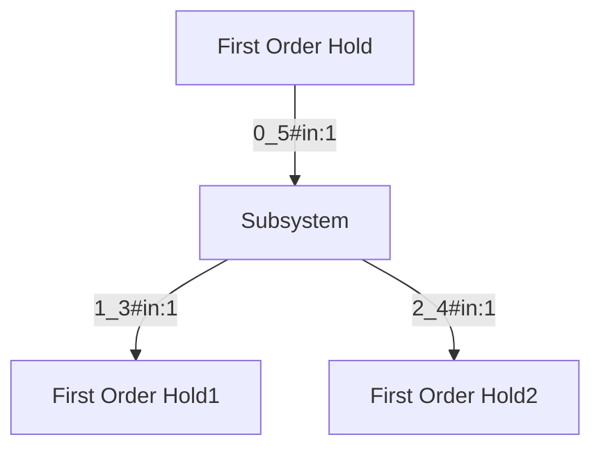

# 基于GPT赋能多信号流图

## 商飞航电系统——甚高频通信系统多信号流图构建

### 部件实体提取

******************************************************************************************************************

**提问**

```
{
    "instruction": "你是航空航电设备领域专门进行实体抽取的专家。请从input中抽取出符合schema定义的实体，不存在的实体类型返回空列表。请按照JSON字符串的格式回答。你可以参考example进行抽取。",
    "schema": [
        "部件"
    ],
    "example": [
        {
            "input": "甚高频通信系统用于进行飞机与飞机、飞机与地面台之间的视距通信。在基本型中，该系统由两套独立的甚高频子系统组成，分别是VHF-1系统和VHF-2系统。选装型中，可能增加VHF-3系统。每个子系统包括一台甚高频通信收发机及其相关的天线",
            "output": {
                "部件": [
                    "甚高频通信系统",
                    "甚高频子系统",
                    "VHF-2系统",
                    "VHF-1系统",
                    "甚高频通信收发机",
                    "天线"
                ]
            }
        },
        {
            "input": "DPP-4抑制剂在特殊人群中的应用",
            "output": {
                "部件": []
            }
        }
    ],
    "input": "甚高频通信收发机型号是VHF-4000，由RC提供。VHF-4000是多信道的收发机，能够提供118.00MHz到136.975MHz频率范围内的DSB（双边带）AM（调幅）音频通信，并能提供25KHz和8.33KHz的频道间隔选择。"
}
```

**回答**

```
{
    "部件": [
        "甚高频通信收发机",
        "VHF-4000",
        "收发机"
    ]
}
```


****************************************************************************************************************

**提问**

```
{
    "instruction": "你是航空航电设备领域专门进行实体抽取的专家。请从input中抽取出符合schema定义的实体，不存在的实体类型返回空列表。请按照JSON字符串的格式回答。你可以参考example进行抽取。",
    "schema": [
        "部件"
    ],
    "example": [
        {
            "input": "甚高频通信系统用于进行飞机与飞机、飞机与地面台之间的视距通信。在基本型中，该系统由两套独立的甚高频子系统组成，分别是VHF-1系统和VHF-2系统。选装型中，可能增加VHF-3系统。每个子系统包括一台甚高频通信收发机及其相关的天线",
            "output": {
                "部件": [
                    "甚高频通信系统",
                    "甚高频子系统",
                    "VHF-2系统",
                    "VHF-1系统",
                    "甚高频通信收发机",
                    "天线"
                ]
            }
        },
        {
            "input": "DPP-4抑制剂在特殊人群中的应用",
            "output": {
                "部件": []
            }
        }
    ],
    "input": "甚高频天线型号为VHFA-2100。VHF-1、VHF-2、VHF-3（选装）天线分别安装在机头下部SD192、机身顶部SD400和SD744（选装）位置。甚高频天线与表面处理过的机身蒙皮直接接触进行搭接，同时天线也通过安装螺钉以及导电密封胶与机身蒙皮进行搭接，满足天线射频搭接要求。天线与收发机之间通过同轴电缆转接。"
}
```

**回答**

```
{
    "部件": [
        "甚高频天线",
        "VHFA-2100",
        "VHF-1天线",
        "VHF-2天线",
        "VHF-3天线",
        "机身蒙皮",
        "安装螺钉",
        "导电密封胶",
        "同轴电缆"
    ]
}
```


********************

****************************************************************************************************************

**提问**

```
{
    "instruction": "你是航空航电设备领域专门进行实体抽取的专家。请从input中抽取出符合schema定义的实体，不存在的实体类型返回空列表。请按照JSON字符串的格式回答。你可以参考example进行抽取。",
    "schema": [
        "部件"
    ],
    "example": [
        {
            "input": "甚高频通信系统用于进行飞机与飞机、飞机与地面台之间的视距通信。在基本型中，该系统由两套独立的甚高频子系统组成，分别是VHF-1系统和VHF-2系统。选装型中，可能增加VHF-3系统。每个子系统包括一台甚高频通信收发机及其相关的天线",
            "output": {
                "部件": [
                    "甚高频通信系统",
                    "甚高频子系统",
                    "VHF-2系统",
                    "VHF-1系统",
                    "甚高频通信收发机",
                    "天线"
                ]
            }
        },
        {
            "input": "DPP-4抑制剂在特殊人群中的应用",
            "output": {
                "部件": []
            }
        }
    ],
    "input": "正常情况下，甚高频通信系统的调谐操作由同侧RTU控制和显示。为提高系统可靠性，对侧RTU也可对甚高频系统进行控制和显示。另外，调谐操作可通过MCDU进行。应急状态下，将RSP面板上的121.5/NORM键控置于121.5位置，可以使VHF-1在121.500MHz的呼救频率上进行通话。
从飞机一开始通电到飞机断电整个期间，VHF通信设备必须始终处于工作状态，以保证与航空公司和空管部门的联系。因此VHF-1收发机由LESS DC汇流条提供28V直流电源，VHF-2收发机由R 28V DC汇流条供电。如果选装了VHF-3系统，则VHF-3收发机由L 28V DC左右汇流条供电。这种设置保证了VHF-1收发机即使在飞机处于应急状态仍能正常工作。
在选装型中，VHF-3系统除了具备语音通信功能外，还具备数据链通信功能。甚高频数据链通信系统能够在地面信息供应者和采用甚高频和SATCOM数据网的飞机之间提供双向的信息和数据文件交换。地面信息提供者处理下行数据链数据信息并将格式化的信息发送给飞机，即对下行链路的信息做出回应。
"
}
```


**回答**

```
{
    "部件": [
        "甚高频通信系统",
        "RTU",
        "MCDU",
        "RSP面板",
        "VHF-1",
        "VHF-2",
        "VHF-3",
        "VHF-1收发机",
        "LESS DC汇流条",
        "VHF-2收发机",
        "R 28V DC汇流条",
        "VHF-3收发机",
        "L 28V DC汇流条",
        "甚高频数据链通信系统",
        "SATCOM数据网"
    ]
}
```

********************
### 部件关系提取


****************************************************************************************************************

**提问**

```
{
    "instruction": "你是航空航电设备领域专门进行关系抽取的专家。请从input中抽取出符合schema定义的关系三元组，不存在的关系返回空列表。请按照JSON字符串的格式回答。你可以参考example进行抽取。",
    "schema": [
        "包含",
        "连接"
        
    ],
    "example": [
        {
            "input": "甚高频通信系统用于进行飞机与飞机、飞机与地面台之间的视距通信。在基本型中，该系统由两套独立的甚高频子系统组成，分别是VHF-1系统和VHF-2系统。选装型中，可能增加VHF-3系统。每个子系统包括一台甚高频通信收发机及其相关的天线",
            "output": {
                "包含": [
                    {
                        "subject": "甚高频通信系统",
                        "object": "甚高频子系统"
                    },
                    {
                        "subject": "甚高频子系统",
                        "object": "甚高频通信收发机"
                    },
                    {
                        "subject": "甚高频子系统",
                        "object": "天线"
                    },
                ]
            }
        },
        {
            "input": "正常情况下，甚高频通信系统的调谐操作由同侧RTU控制和显示。为提高系统可靠性，对侧RTU也可对甚高频系统进行控制和显示。另外，调谐操作可通过MCDU进行。应急状态下，将RSP面板上的121.5/NORM键控置于121.5位置，可以使VHF-1在121.500MHz的呼救频率上进行通话。
从飞机一开始通电到飞机断电整个期间，VHF通信设备必须始终处于工作状态，以保证与航空公司和空管部门的联系。因此VHF-1收发机由LESS DC汇流条提供28V直流电源，VHF-2收发机由R 28V DC汇流条供电。如果选装了VHF-3系统，则VHF-3收发机由L 28V DC左右汇流条供电。这种设置保证了VHF-1收发机即使在飞机处于应急状态仍能正常工作。
在选装型中，VHF-3系统除了具备语音通信功能外，还具备数据链通信功能。甚高频数据链通信系统能够在地面信息供应者和采用甚高频和SATCOM数据网的飞机之间提供双向的信息和数据文件交换。地面信息提供者处理下行数据链数据信息并将格式化的信息发送给飞机，即对下行链路的信息做出回应。",
            "output": {
                "包含": [
                    {
                        "subject": "VHF-3",
                        "object": "甚高频数据链通信系统"
                    }
                ],
                "连接":[
                    {
                        "subject": "VHF-1收发机",
                        "object": "LESS DC汇流条"
                    },
                    {
                        "subject": "VHF-2收发机",
                        "object": "R 28V DC汇流条"
                    },
                    {
                        "subject": "VHF-3系统",
                        "object": "L 28V DC左右汇流条"
                    },
                ]
            }
        }
    ],
    "input": "ARJ21-700飞机的通信系统主要提供飞机上的机组人员与飞机外界的通信以及飞机内部不同位置处的通信联络。飞机与外界的通信，包括飞机与地面管制人员或者与其他飞机之间的相互通信，这主要是通过无线电通信来完成的。飞机内部之间的相互通信，是靠有线通信网络来完成的。目前，最主要的通信方式还是以语音通信为主，ARJ21-700飞机的语音无线电通信包括甚高频通信子系统和高频通信子系统。随着技术的发展，数据通信在航空通信中占据越来越多的位置，在ARJ21-700飞机上，数据通信作为选装项，可根据用户的需要安装数据链通信系统，通过它可以进行空地之间的数据和信息的自动传输交换，例如，飞机的离场、起飞、着陆、进入登机门时间，发动机参数，飞机故障等可立即自动向地面报告，无需飞行员参与报告。这样可使地面随时了解飞机状态，便于进行生产调度和维修安排。
ARJ21-700飞机通信系统包括甚高频通信、高频通信、选择呼叫、旅客广播、内话和音频综合、音频记录、应急定位发射、驾驶舱门监视等子系统。
ARJ21飞机导航系统主要用来引导飞机安全准确地沿着所选定的路线，准时地到达目的地。导航系统主要由飞行环境数据、姿态和航向、着陆与滑行、自主定位、非自主定位和飞行管理计算共6类分系统组成，向机组提供保证飞机安全飞行和导引飞机按规定航线飞行的目视和音响信息。ARJ21飞机无线电导航系统由以下子系统组成：甚高频导航系统（包括指点信标、仪表着陆系统和甚高频全向信标）、测距器、自动定向仪。
"
}
```

**回答**

```
{
    "包含": [
        {
            "subject": "ARJ21-700飞机通信系统",
            "object": "甚高频通信子系统"
        },
        {
            "subject": "ARJ21-700飞机通信系统",
            "object": "高频通信子系统"
        },
        {
            "subject": "ARJ21-700飞机通信系统",
            "object": "数据链通信系统"
        },
        {
            "subject": "ARJ21飞机导航系统",
            "object": "飞行环境数据子系统"
        },
        {
            "subject": "ARJ21飞机导航系统",
            "object": "姿态和航向子系统"
        },
        {
            "subject": "ARJ21飞机导航系统",
            "object": "着陆与滑行子系统"
        },
        {
            "subject": "ARJ21飞机导航系统",
            "object": "自主定位子系统"
        },
        {
            "subject": "ARJ21飞机导航系统",
            "object": "非自主定位子系统"
        },
        {
            "subject": "ARJ21飞机导航系统",
            "object": "飞行管理计算子系统"
        },
        {
            "subject": "ARJ21飞机无线电导航系统",
            "object": "甚高频导航系统"
        },
        {
            "subject": "ARJ21飞机无线电导航系统",
            "object": "测距器"
        },
        {
            "subject": "ARJ21飞机无线电导航系统",
            "object": "自动定向仪"
        },
        {
            "subject": "甚高频导航系统",
            "object": "指点信标"
        },
        {
            "subject": "甚高频导航系统",
            "object": "仪表着陆系统"
        },
        {
            "subject": "甚高频导航系统",
            "object": "甚高频全向信标"
        }
    ],
    "连接": []
}

```


********************

### 三元组抽取


*********************************

**提问**

```
你是三元组提取专家 从以下文本尽可能提取         "甚高频通信系统",
        "RTU",
        "MCDU",
        "RSP面板",
        "VHF-1",
        "VHF-2",
        "VHF-3",
        "VHF-1收发机",
        "LESS DC汇流条",
        "VHF-2收发机",
        "R 28V DC汇流条",
        "VHF-” 部件的三元组
"正常情况下，甚高频通信系统的调谐操作由同侧RTU控制和显示。为提高系统可靠性，对侧RTU也可对甚高频系统进行控制和显示。另外，调谐操作可通过MCDU进行。应急状态下，将RSP面板上的121.5/NORM键控置于121.5位置，可以使VHF-1在121.500MHz的呼救频率上进行通话。
从飞机一开始通电到飞机断电整个期间，VHF通信设备必须始终处于工作状态，以保证与航空公司和空管部门的联系。因此VHF-1收发机由LESS DC汇流条提供28V直流电源，VHF-2收发机由R 28V DC汇流条供电。如果选装了VHF-3系统，则VHF-3收发机由L 28V DC左右汇流条供电。这种设置保证了VHF-1收发机即使在飞机处于应急状态仍能正常工作。
在选装型中，VHF-3系统除了具备语音通信功能外，还具备数据链通信功能。甚高频数据链通信系统能够在地面信息供应者和采用甚高频和SATCOM数据网的飞机之间提供双向的信息和数据文件交换。地面信息提供者处理下行数据链数据信息并将格式化的信息发送给飞机，即对下行链路的信息做出回应。
```


**回答**

```
{
    "包含": [],
    "连接": [
        {
            "subject": "甚高频通信系统",
            "object": "RTU"
        },
        {
            "subject": "甚高频通信系统",
            "object": "MCDU"
        },
        {
            "subject": "甚高频通信系统",
            "object": "RSP面板"
        },
        {
            "subject": "RSP面板",
            "object": "VHF-1"
        },
        {
            "subject": "VHF-1收发机",
            "object": "LESS DC汇流条"
        },
        {
            "subject": "VHF-2收发机",
            "object": "R 28V DC汇流条"
        },
        {
            "subject": "VHF-3系统",
            "object": "L 28V DC左右汇流条"
        }
    ]
}

```


********************

### 数据扩充

*********************************

**提问**

```
以下是一个针对航空航电系统的关系抽取数据集的样本，关系类型为“system:controlled_by”：

关系：system:controlled_by。
上下文：正常情况下，甚高频通信系统的调谐操作由同侧RTU控制和显示。为提高系统可靠性，对侧RTU也可对甚高频系统进行控制和显示。另外，调谐操作可通过MCDU进行。
头实体：甚高频通信系统。
头实体类型：SYSTEM。
尾实体：RTU。
尾实体类型：EQUIPMENT。

关系：system:controlled_by。
上下文：应急状态下，将RSP面板上的121.5/NORM键控置于121.5位置，可以使VHF-1在121.500MHz的呼救频率上进行通话。
头实体：VHF-1。
头实体类型：EQUIPMENT。
尾实体：RSP面板。
尾实体类型：EQUIPMENT。

关系：system:powered_by。
上下文：从飞机一开始通电到飞机断电整个期间，VHF通信设备必须始终处于工作状态，以保证与航空公司和空管部门的联系。因此VHF-1收发机由LESS DC汇流条提供28V直流电源，VHF-2收发机由R 28V DC汇流条供电。
头实体：VHF-1收发机。
头实体类型：EQUIPMENT。
尾实体：LESS DC汇流条。
尾实体类型：EQUIPMENT。

关系：system:powered_by。
上下文：从飞机一开始通电到飞机断电整个期间，VHF通信设备必须始终处于工作状态，以保证与航空公司和空管部门的联系。因此VHF-1收发机由LESS DC汇流条提供28V直流电源，VHF-2收发机由R 28V DC汇流条供电。
头实体：VHF-2收发机。
头实体类型：EQUIPMENT。
尾实体：R 28V DC汇流条。
尾实体类型：EQUIPMENT。

关系：system:includes。
上下文：在选装型中，VHF-3系统除了具备语音通信功能外，还具备数据链通信功能。甚高频数据链通信系统能够在地面信息供应者和采用甚高频和SATCOM数据网的飞机之间提供双向的信息和数据文件交换。
头实体：VHF-3系统。
头实体类型：SYSTEM。
尾实体：甚高频数据链通信系统。
尾实体类型：SYSTEM。

关系：system:controlled_by。
上下文：另外，调谐操作可通过MCDU进行。
头实体：甚高频通信系统。
头实体类型：SYSTEM。
尾实体：MCDU。
尾实体类型：EQUIPMENT。
Generate more samples for the relation 'system:controlled_by'.
```


**回答**

```
以下是更多关于关系“system:controlled_by”的样本：

关系：system:controlled_by。
上下文：自动驾驶系统通过飞行管理系统（FMS）进行控制，确保飞机按照预定航线飞行。
头实体：自动驾驶系统。
头实体类型：SYSTEM。
尾实体：飞行管理系统（FMS）。
尾实体类型：EQUIPMENT。

关系：system:controlled_by。
上下文：环境控制系统由中央处理器进行监控和调整，以保持客舱内适宜的温度和湿度。
头实体：环境控制系统。
头实体类型：SYSTEM。
尾实体：中央处理器。
尾实体类型：EQUIPMENT。

关系：system:controlled_by。
上下文：飞机的飞行控制系统通过操纵杆和方向舵踏板进行操作，确保飞行员能够有效地控制飞机。
头实体：飞行控制系统。
头实体类型：SYSTEM。
尾实体：操纵杆。
尾实体类型：EQUIPMENT。

关系：system:controlled_by。
上下文：导航系统的运行由惯性导航系统（INS）和全球定位系统（GPS）共同控制，确保飞机的精确定位。
头实体：导航系统。
头实体类型：SYSTEM。
尾实体：惯性导航系统（INS）。
尾实体类型：EQUIPMENT。

关系：system:controlled_by。
上下文：火警检测系统由驾驶舱控制面板上的警报器进行监控，及时提醒飞行员火灾的发生。
头实体：火警检测系统。
头实体类型：SYSTEM。
尾实体：警报器。
尾实体类型：EQUIPMENT。

关系：system:controlled_by。
上下文：飞行数据记录系统由中央计算机控制，记录所有飞行参数以备后续分析。
头实体：飞行数据记录系统。
头实体类型：SYSTEM。
尾实体：中央计算机。
尾实体类型：EQUIPMENT。

关系：system:controlled_by。
上下文：天气雷达系统由驾驶舱中的显示屏进行控制和显示，为飞行员提供实时天气信息。
头实体：天气雷达系统。
头实体类型：SYSTEM。
尾实体：显示屏。
尾实体类型：EQUIPMENT。

关系：system:controlled_by。
上下文：燃油管理系统通过中央处理单元（CPU）进行监控和管理，确保燃油的高效使用和分配。
头实体：燃油管理系统。
头实体类型：SYSTEM。
尾实体：中央处理单元（CPU）。
尾实体类型：EQUIPMENT。
```


********************

### 利用代码结构优化从文本中提取三元组的能力

*********************************

**提问**

```
from typing import List

class Rel:
    def __init__(self, name: str):
        self.name = name

class Controlled_by(Rel):
    def __init__(self, name: str):
        super().__init__(name=name)

class Powered_by(Rel):
    def __init__(self, name: str):
        super().__init__(name=name)

class Includes(Rel):
    def __init__(self, name: str):
        super().__init__(name=name)

class Entity:
    def __init__(self, name: str):
        self.name = name

class System(Entity):
    def __init__(self, name: str):
        super().__init__(name=name)

class Equipment(Entity):
    def __init__(self, name: str):
        super().__init__(name=name)

class Triple:
    def __init__(self, head: Entity, relation: Rel, tail: Entity):
        self.head = head
        self.relation = relation
        self.tail = tail

class Extract:
    def __init__(self, triples: List[Triple] = []):
        self.triples = triples
用以上逻辑描述以下文本
ARJ21-700飞机的通信系统主要提供飞机上的机组人员与飞机外界的通信以及飞机内部不同位置处的通信联络。飞机与外界的通信，包括飞机与地面管制人员或者与其他飞机之间的相互通信，这主要是通过无线电通信来完成的。飞机内部之间的相互通信，是靠有线通信网络来完成的。目前，最主要的通信方式还是以语音通信为主，ARJ21-700飞机的语音无线电通信包括甚高频通信子系统和高频通信子系统。随着技术的发展，数据通信在航空通信中占据越来越多的位置，在ARJ21-700飞机上，数据通信作为选装项，可根据用户的需要安装数据链通信系统，通过它可以进行空地之间的数据和信息的自动传输交换，例如，飞机的离场、起飞、着陆、进入登机门时间，发动机参数，飞机故障等可立即自动向地面报告，无需飞行员参与报告。这样可使地面随时了解飞机状态，便于进行生产调度和维修安排。
ARJ21-700飞机通信系统包括甚高频通信、高频通信、选择呼叫、旅客广播、内话和音频综合、音频记录、应急定位发射、驾驶舱门监视等子系统。
ARJ21飞机导航系统主要用来引导飞机安全准确地沿着所选定的路线，准时地到达目的地。导航系统主要由飞行环境数据、姿态和航向、着陆与滑行、自主定位、非自主定位和飞行管理计算共6类分系统组成，向机组提供保证飞机安全飞行和导引飞机按规定航线飞行的目视和音响信息。ARJ21飞机无线电导航系统由以下子系统组成：甚高频导航系统（包括指点信标、仪表着陆系统和甚高频全向信标）、测距器、自动定向仪。


```


**回答**

```
# 定义节点和关系
arj21_700_communication_system = System("ARJ21-700飞机通信系统")
arj21_700_voice_radio_communication = System("ARJ21-700飞机的语音无线电通信")
vhf_communication_subsystem = System("甚高频通信子系统")
hf_communication_subsystem = System("高频通信子系统")
data_link_communication_system = System("数据链通信系统")
selective_calling = System("选择呼叫")
passenger_broadcast = System("旅客广播")
interphone_and_audio_integration = System("内话和音频综合")
audio_recording = System("音频记录")
emergency_locator_transmitter = System("应急定位发射")
cockpit_door_monitoring = System("驾驶舱门监视")
arj21_navigation_system = System("ARJ21飞机导航系统")
flight_environment_data = System("飞行环境数据")
attitude_and_heading = System("姿态和航向")
landing_and_taxiing = System("着陆与滑行")
self_positioning = System("自主定位")
non_self_positioning = System("非自主定位")
flight_management_computing = System("飞行管理计算")
vhf_navigation_system = System("甚高频导航系统")
marker_beacon = System("指点信标")
instrument_landing_system = System("仪表着陆系统")
vhf_omnidirectional_radio_range = System("甚高频全向信标")
distance_measuring_equipment = System("测距器")
automatic_direction_finder = System("自动定向仪")

# 定义关系
includes = Includes("includes")

# 创建三元组
triples = [
    Triple(arj21_700_communication_system, includes, arj21_700_voice_radio_communication),
    Triple(arj21_700_voice_radio_communication, includes, vhf_communication_subsystem),
    Triple(arj21_700_voice_radio_communication, includes, hf_communication_subsystem),
    Triple(arj21_700_communication_system, includes, data_link_communication_system),
    Triple(arj21_700_communication_system, includes, selective_calling),
    Triple(arj21_700_communication_system, includes, passenger_broadcast),
    Triple(arj21_700_communication_system, includes, interphone_and_audio_integration),
    Triple(arj21_700_communication_system, includes, audio_recording),
    Triple(arj21_700_communication_system, includes, emergency_locator_transmitter),
    Triple(arj21_700_communication_system, includes, cockpit_door_monitoring),
    Triple(arj21_navigation_system, includes, flight_environment_data),
    Triple(arj21_navigation_system, includes, attitude_and_heading),
    Triple(arj21_navigation_system, includes, landing_and_taxiing),
    Triple(arj21_navigation_system, includes, self_positioning),
    Triple(arj21_navigation_system, includes, non_self_positioning),
    Triple(arj21_navigation_system, includes, flight_management_computing),
    Triple(arj21_navigation_system, includes, vhf_navigation_system),
    Triple(vhf_navigation_system, includes, marker_beacon),
    Triple(vhf_navigation_system, includes, instrument_landing_system),
    Triple(vhf_navigation_system, includes, vhf_omnidirectional_radio_range),
    Triple(arj21_navigation_system, includes, distance_measuring_equipment),
    Triple(arj21_navigation_system, includes, automatic_direction_finder)
]

# 提取
extract = Extract(triples=triples)

# 打印结果
for triple in extract.triples:
    print(f"Head: {triple.head.name}, Relation: {triple.relation.name}, Tail: {triple.tail.name}")
```


********************


*********************************

**提问**


**回答**

********************


*********************************

**提问**


**回答**

********************

## langchain

[langchain/libs/experimental/langchain_experimental/graph_transformers/llm.py at master · langchain-ai/langchain (github.com)](https://github.com/langchain-ai/langchain/blob/master/libs/experimental/langchain_experimental/graph_transformers/llm.py)

langchainSmith

```
    base_string_parts = [
        "You are a top-tier algorithm designed for extracting information in "
        "structured formats to build a knowledge graph. Your task is to identify "
        "the entities and relations requested with the user prompt from a given "
        "text. You must generate the output in a JSON format containing a list "
        'with JSON objects. Each object should have the keys: "head", '
        '"head_type", "relation", "tail", and "tail_type". The "head" '
        "key must contain the text of the extracted entity with one of the types "
        "from the provided list in the user prompt.",
        f'The "head_type" key must contain the type of the extracted head entity, '
        f"which must be one of the types from {node_labels_str}."
        if node_labels
        else "",
        f'The "relation" key must contain the type of relation between the "head" '
        f'and the "tail", which must be one of the relations from {rel_types_str}.'
        if rel_types
        else "",
        f'The "tail" key must represent the text of an extracted entity which is '
        f'the tail of the relation, and the "tail_type" key must contain the type '
        f"of the tail entity from {node_labels_str}."
        if node_labels
        else "",
        "Attempt to extract as many entities and relations as you can. Maintain "
        "Entity Consistency: When extracting entities, it's vital to ensure "
        'consistency. If an entity, such as "John Doe", is mentioned multiple '
        "times in the text but is referred to by different names or pronouns "
        '(e.g., "Joe", "he"), always use the most complete identifier for '
        "that entity. The knowledge graph should be coherent and easily "
        "understandable, so maintaining consistency in entity references is "
        "crucial.",
        "IMPORTANT NOTES:\n- Don't add any explanation and text.",
```


```
human_prompt = PromptTemplate(
        template="""Based on the following example, extract entities and 
relations from the provided text.\n\n
Use the following entity types, don't use other entity that is not defined below:
# ENTITY TYPES:
{node_labels}

Use the following relation types, don't use other relation that is not defined below:
# RELATION TYPES:
{rel_types}

Below are a number of examples of text and their extracted entities and relationships.
{examples}

For the following text, extract entities and relations as in the provided example.
{format_instructions}\nText: {input}""",
        input_variables=["input"],
        partial_variables={
            "format_instructions": parser.get_format_instructions(),
            "node_labels": node_labels,
            "rel_types": rel_types,
            "examples": examples,
        },
    )
```


## ONEKE

实体命名识别 NER

```
{
	"instruction": "你是专门进行实体抽取的专家。请从input中抽取出符合schema定义的实体，不存在的实体类型返回空列表。请按照JSON字符串的格式回答。",
	"schema": ["人名", "学历", "职位", "国籍"],
	"input": "刘志坚先生：1956年出生，中国国籍，无境外居留权，中共党员，大专学历，高级经济师。"
}
```

关系识别 RE

```
{
	"instruction": "你是专门进行关系抽取的专家。请从input中抽取出符合schema定义的关系三元组，不存在的关系返回空列表。请按照JSON字符串的格式回答。",
	"schema": ["饰演", "主角", "父亲", "母亲"],
	"input": "古往今来，能饰演古龙小说人物“楚留香”的，无一不是娱乐圈公认的美男子，2011年，36岁的张智尧在《楚留香新传》里饰演楚留香，依旧帅得让人无法自拔"
}
```

知识图谱构建

```
{
    "instruction": "你是一个图谱实体知识结构化专家。根据输入实体类型(entity type)的schema描述，从文本中抽取出相应的实体实例和其属性信息，不存在的属性不输出, 属性存在多值就返回列表，并输出为可解析的json格式。", 
    "schema": [
    {
        "entity_type": "人物", 
        "attributes": [ "中文名","英文名","祖籍","出生日期","出生地点","职业", "毕业学校", "作品","奖项"]
    }
    ], 
    "input": "周杰伦（Jay Chou），1979年1月18日出生于台湾省新北市，祖籍福建省泉州市永春县，华语流行乐男歌手、音乐人、演员、导演、编剧，毕业于淡江中学。2000年，发行个人首张音乐专辑《Jay》。2001年，凭借专辑《范特西》奠定其融合中西方音乐的风格。2002年，举行“The One”世界巡回演唱会；同年，凭借歌曲《爱在西元前》获得第13届台湾金曲奖最佳作曲人奖。"
}
```

由于example示例通常较长, 模型训练最大长度有限, 过多的example可能导致模型的效果反而不好, 因此我们建议给2个example, 一个正例, 一个反例, 并且限制schema的数量在1个。

实体提取

```
{
    "instruction": "你是专门进行实体抽取的专家。请从input中抽取出符合schema定义的实体，不存在的实体类型返回空列表。请按照JSON字符串的格式回答。你可以参考example进行抽取。",
    "schema": [
        "检查指标"
    ],
    "example": [
        {
            "input": "CKD诊断标准：1.以下任意一项指标持续超过3个月；且至少满足1项。(1)肾损伤标志：白蛋白尿[尿白蛋白排泄率(AER)≥30mg／24h；尿白蛋白肌酐比值(ACR)≥3mg／mmol]；尿沉渣异常；肾小管相关病变；组织学异常；影像学所见结构异常；肾移植病史。(2)肾小球滤过率下降：eGFR≤60ml·min-1·1.73m-2 ",
            "output": {
                "检查指标": [
                    "尿白蛋白排泄率(AER)",
                    "尿白蛋白肌酐比值(ACR)",
                    "肾小球滤过率",
                    "eGFR"
                ]
            }
        },
        {
            "input": "DPP-4抑制剂在特殊人群中的应用",
            "output": {
                "检查指标": []
            }
        }
    ],
    "input": "目前所有磺脲类药物说明书均将重度肝功能不全列为禁忌证。丙氨酸氨基转移酶(alanine transaminase，ALT)>3倍参考值上限可作为肝损害的敏感而特异的指标，若ALT>8~10倍参考值上限或者ALT>3倍参考值上限且血清总胆红素(total bilirubin，TBIL)>2倍参考值上限则是预测重度肝损害的特异指标，表明肝脏实质细胞受到损害，此时应禁用磺脲类药物。在临床使用中，伴有肝性脑病、腹水或凝血障碍的失代偿肝硬化患者应禁用该类药物以防发生低血糖。"
}
```

关系提取

```
{
    "instruction": "你是专门进行关系抽取的专家。请从input中抽取出符合schema定义的关系三元组，不存在的关系返回空列表。请按照JSON字符串的格式回答。你可以参考example进行抽取。",
    "schema": [
        "疾病的分期分型"
    ],
    "example": [
        {
            "input": "糖尿病的基础治疗包括教育和管理、饮食和运动两方面。缺乏糖尿病防治知识是血糖控制差的最主要原因。重视老年患者的教育和管理是提高糖尿病治疗水平的重要举措。",
            "output": {
                "疾病的分期分型": []
            }
        },
        {
            "input": "格列喹酮的代谢产物无降糖作用且大部分从粪便排泄，仅5.0%经肾脏排泄，受肾功能影响较小，但用于慢性肾脏病患者的大型临床研究有限。曾有研究观察格列喹酮用于GFR10~50mlmin-1.(1.73m2)-1患者，但试验设计不尽完善。格列喹酮可用于慢性肾脏病1~3期的患者且无需调整剂量；4期需谨慎用药；5期禁用。",
            "output": {
                "疾病的分期分型": [
                    {
                        "subject": "慢性肾脏病",
                        "object": "慢性"
                    },
                    {
                        "subject": "慢性肾脏病",
                        "object": "慢性"
                    },
                    {
                        "subject": "慢性肾脏病",
                        "object": "1~3期"
                    },
                    {
                        "subject": "慢性肾脏病",
                        "object": "4期"
                    },
                    {
                        "subject": "慢性肾脏病",
                        "object": "5期"
                    }
                ]
            }
        }
    ],
    "input": "(2)NSAIDs：包括非选择性环氧化酶(COX)抑制剂COX-2抑制剂两种，若无禁忌推荐早期足量使用NSAIDs速效制剂。非选择性COX抑制剂主要存在消化道溃道溃疡，胃肠道穿孔、上消化道出血等胃肠道不良反应，对于不耐受非选择性COX抑制剂的患者可选用COX-2抑制剂，其胃肠道不良反应可降低50％；活动性消化道溃疡／出血，或既往有复发性消化道溃疡／出血病史者为所有NSAIDs使用禁忌症。COX-2抑制剂可能引起心血管事件的危险性增加，合并心肌梗死、心功能不全者避免使用。NSAIDs中使用过程中需监测肾功能，严重慢性肾脏病(G4～5期)未透析患者不建议使用。"
}
```

```
    'NERzh': "你是专门进行实体抽取的专家。请从input中抽取出符合schema定义的实体，不存在的实体类型返回空列表。请按照JSON字符串的格式回答。",
    'REzh': "你是专门进行关系抽取的专家。请从input中抽取出符合schema定义的关系三元组，不存在的关系返回空列表。请按照JSON字符串的格式回答。",
    'EEzh': "你是专门进行事件提取的专家。请从input中抽取出符合schema定义的事件，不存在的事件返回空列表，不存在的论元返回NAN，如果论元存在多值请返回列表。请按照JSON字符串的格式回答。",
    'EETzh': "你是专门进行事件提取的专家。请从input中抽取出符合schema定义的事件类型及事件触发词，不存在的事件返回空列表。请按照JSON字符串的格式回答。",
    'EEAzh': "你是专门进行事件论元提取的专家。请从input中抽取出符合schema定义的事件论元及论元角色，不存在的论元返回NAN或空字典，如果论元存在多值请返回列表。请按照JSON字符串的格式回答。",
    'KGzh': '你是一个图谱实体知识结构化专家。根据输入实体类型(entity type)的schema描述，从文本中抽取出相应的实体实例和其属性信息，不存在的属性不输出, 属性存在多值就返回列表，并输出为可解析的json格式。',
```


## UnleashLLMRE

```
instruction="使用自然语言抽取三元组,已知下列句子,请从句子中抽取出可能的实体、关系,抽取实体类型为{'专业','时间','人类','组织','地理地区','事件'},关系类型为{'体育运动','包含行政领土','参加','国家','邦交国','夺得','举办地点','属于','获奖'},你可以先识别出实体再判断实体之间的关系,以(头实体,关系,尾实体)的形式回答"
input="2006年，弗雷泽出战中国天津举行的女子水球世界杯，协助国家队夺得冠军。2008年，弗雷泽代表澳大利亚参加北京奥运会女子水球比赛，赢得铜牌。"
output="(弗雷泽,获奖,铜牌)(女子水球世界杯,举办地点,天津)(弗雷泽,属于,国家队)(弗雷泽,国家,澳大利亚)(弗雷泽,参加,北京奥运会女子水球比赛)(中国,包含行政领土,天津)(中国,邦交国,澳大利亚)(北京奥运会女子水球比赛,举办地点,北京)(女子水球世界杯,体育运动,水球)(国家队,夺得,冠军)"
```


数据增强

```
    One sample in relation extraction datasets consists of a relation, a context, a pair of head and tail entities in the context and their entity types. 
    The head entity has the relation with the tail entity and entities are pre-categorized as the following types: URL, LOCATION, IDEOLOGY, CRIMINAL CHARGE, TITLE, STATE OR PROVINCE, DATE, PERSON, NUMBER, CITY, DURATION, CAUSE OF DEATH, COUNTRY, NATIONALITY, RELIGION, ORGANIZATION, MISCELLANEOUS. 
    Here are some samples for relation 'org:founded_by':
    Relation: org:founded_by. Context: President Lee Teng-hui confers the Order of the Brilliant Star with a Violet Grand Cordon on Samuel Noordhoff , founder of the Noordhoff Craniofacial Foundation , for his devoted service to local citizens over the past four decades. Head Entity: Noordhoff Craniofacial Foundation . Head Type: ORGANIZATION. Tail Entity: Samuel Noordhoff. Tail Type: PERSON.
    Relation: org:founded_by. Context: Talansky is also the US contact for the New Jerusalem Foundation , an organization founded by Olmert while he was Jerusalem 's mayor . Head Entity: New Jerusalem Foundation. Head Type: ORGANIZATION. Tail Entity: Olmert. Tail Type: PERSON.
    Relation: org:founded_by. Context: Sharpton has said he will not endorse any candidate until hearing more about their views on civil rights and other issues at his National Action Network convention next week in New York City . Head Entity: National Action Network. Head Type: ORGANIZATION. Tail Entity: his. Tail Type: PERSON.
    Relation: org:founded_by. Context: `` We believe that we can best serve our clients by offering a single multistrategy hedge fund platform , '' wrote John Havens , who was a founder of Old Lane with Pandit and is president of the alternative investment group . Head Entity: Old Lane. Head Type: ORGANIZATION. Tail Entity: John Havens. Tail Type: PERSON.
    Generate more samples for the relation 'org:founded_by'.
```

数据

## Codekgc

[DeepKE/example/llm/CodeKGC/codekgc.py at main · zjunlp/DeepKE (github.com)](https://github.com/zjunlp/DeepKE/blob/main/example/llm/CodeKGC/codekgc.py)

prompt如下

```
'''
from typing import List
class Rel:
    def __init__(self, name: str):
        self.name = name
class Work_for(Rel):
    def __init__(self, name: str):
        super.__init__(name=name)
class Kill(Rel):
    def __init__(self, name: str):
        super.__init__(name=name)
class Organization_based_in(Rel):
    def __init__(self, name: str):
        super.__init__(name=name)
class Live_in(Rel):
    def __init__(self, name: str):
        super.__init__(name=name)
class Located_in(Rel):
    def __init__(self, name: str):
        super.__init__(name=name)

class Entity:
    def __init__(self, name: str):
        self.name = name
class person(Entity):
    def __init__(self, name: str):
        super.__init__(name=name)
class organization(Entity):
    def __init__(self, name: str):
        super.__init__(name=name)
class location(Entity):
    def __init__(self, name: str):
        super.__init__(name=name)

class Triple:
    def __init__(self, head: Entity, relation: Rel, tail: Entity):
        self.head = head
        self.relation = relation
        self.tail = tail
class Extract:
    def __init__(self, triples: List[Triple] = []):
        self.triples = triples
‘’‘
""" Another type of plan , first advocated by Sen. Donald W. Riegle Jr. , D-Mich. , chairman of the Senate Banking Committee , doesn 't waive Gramm-Rudman. """
extract = Extract([Triple(person('Donald W. Riegle Jr.'), Rel('Work for'), organization('Senate Banking Committee')),])
""" The spy , high-ranking Korean CIA official Sohn Ho Young , wanted to defect because he was about to be transferred home from a post in New York City , the newspaper said . """
extract = Extract([Triple(person('Sohn Ho Young'), Rel('Work for'), organization('Korean CIA')),])
""" Reynie Ortiz , resident of U S West International , said the franchise is important because Hong Kong is growing as an international trade center and a gateway to Asian business. """
extract = Extract([Triple(person('Reynie Ortiz'), Rel('Work for'), organization('U S West International')),])
""" Most of the work conducted by the Warren Commission , which concluded that Lee Harvey Oswald acted alone in the Kennedy slaying , has been opened to the public , a move that has helped researchers evaluate _ and in many cases strongly criticize _ that investigation . """
extract = Extract([Triple(person('Lee Harvey Oswald'), Rel('Kill'), person('Kennedy')),])
""" Sen. Edward M. Kennedy says his family is disturbed by the decision to establish a museum in the Dallas building from which Lee Harvey Oswald is believed to have shot President John F. Kennedy . """
extract = Extract([Triple(person('Lee Harvey Oswald'), Rel('Kill'), person('President John F. Kennedy')),])
""" The summary also concluded that Sirhan , who is serving a life sentence at Soledad Prison for the killing , was sane and was not under the influence of alcohol when he shot Kennedy moments after he had claimed victory in the California Democratic presidential primary . """
extract = Extract([Triple(person('Sirhan'), Rel('Kill'), person('Kennedy')),])
""" BELGRADE , Yugoslavia ( AP ) """
extract = Extract([Triple(location('BELGRADE'), Rel('Located in'), location('Yugoslavia')),
                   Triple(organization('AP'), Rel('Organization based in'), location('BELGRADE')),
                   Triple(organization('AP'), Rel('Organization based in'), location('Yugoslavia')),])
""" ` ` From the onset , we at the Texas Department of Agriculture felt that more was at stake than steak , and a whole lot more was at stake than growth hormones , ' ' said Texas Agriculture Commissioner Jim Hightower at a news conference Monday. """
extract = Extract([Triple(organization('Texas Department of Agriculture'), Rel('Organization based in'), location('Texas')),
                   Triple(person('Jim Hightower'), Rel('Work for'), organization('Texas Department of Agriculture')),
                   Triple(person('Jim Hightower'), Rel('Live in'), location('Texas')),])
""" Bradley First Air of Carp , Ontario , which owned the plane , said the crew members were pilots from Montreal and Ottawa . """
extract = Extract([Triple(organization('Bradley First Air of Carp'), Rel('Organization based in'), location('Ontario')),])
""" The June celebration of cruising , started two years after Modesto native George Lucas ' film was released in 1973 , draws up to 100 , 000 people in 30 , 000 cars . """
extract = Extract([Triple(person('George Lucas'), Rel('Live in'), location('Modesto')),])
""" ` ` You can count it on your fingertips , ' ' said veteran Miami Beach political Gerald Schwartz. """
extract = Extract([Triple(person('Gerald Schwartz.'), Rel('Live in'), location('Miami Beach')),])
""" In 1856 , the 28th President of the United States , Thomas Woodrow Wilson , was born in Staunton , Va . """
extract = Extract([Triple(person('Thomas Woodrow Wilson'), Rel('Live in'), location('Staunton , Va')),])
""" An estimated one in four Argentina 's 31 million people lives in poverty ; 820 , 000 people in Buenos Aires Province alone eat at least one meal a day at some 1 , 500 soup kitchens that have opened , according to Gov. Antonio Cafiero. """
extract = Extract([Triple(location('Buenos Aires Province'), Rel('Located in'), location('Argentina')),
                   Triple(person('Antonio Cafiero.'), Rel('Live in'), location('Argentina')),
                   Triple(person('Antonio Cafiero.'), Rel('Live in'), location('Buenos Aires Province')),])
""" HUNTINGTON , Ind . """
extract = Extract([Triple(location('HUNTINGTON'), Rel('Located in'), location('Ind .')),])
""" Trump plans to display the window in the Taj Mahal , a hotel he 's building in Atlantic City , according to Patti Fox , who bid on Trump 's behalf after he made a brief appearance at the auction . """
extract = Extract([Triple(location('Taj Mahal'), Rel('Located in'), location('Atlantic City')),])
“”“中国是个好地方”“”
```


## 多信号流图生成辅助

### 实体提取

### 连线辅助

### 多信号流图构成辅助

[DeepKE/example/llm/CodeKGC at main · zjunlp/DeepKE (github.com)](https://github.com/zjunlp/DeepKE/tree/main/example/llm/CodeKGC)

### GPT辅助框架识别故障树

#### example1

**提问**


用python class 继承表示这个图里面的关系

**回答**

```python
class ACPFailure:
    def __init__(self, name, q_value):
        self.name = name
        self.q_value = q_value
        self.children = []

    def add_child(self, child):
        self.children.append(child)

    def __repr__(self):
        return f"{self.name} (Q={self.q_value})"


class TotalACPFailure(ACPFailure):
    def __init__(self, name="丧失ACP全部功能", q_value=7.39e-12):
        super().__init__(name, q_value)


class FirstACPFailure(ACPFailure):
    def __init__(self, q_value=0.000224):
        super().__init__("第一套ACP失效", q_value)


class SecondACPFailure(ACPFailure):
    def __init__(self, q_value=0.000282):
        super().__init__("第二套ACP失效", q_value)


class ThirdACPFailure(ACPFailure):
    def __init__(self, q_value=0.000117):
        super().__init__("第三套ACP失效", q_value)


# 创建节点
total_acp_failure = TotalACPFailure()

first_acp_failure = FirstACPFailure()
second_acp_failure = SecondACPFailure()
third_acp_failure = ThirdACPFailure()

l_acp_failure = ACPFailure("L_ACP FAILURE", 0.000224)
r_acp_failure = ACPFailure("R_ACP FAILURE", 0.000282)
c_acp_failure = ACPFailure("C_ACP FAILURE", 0.000117)

# 构建关系
total_acp_failure.add_child(first_acp_failure)
total_acp_failure.add_child(second_acp_failure)
total_acp_failure.add_child(third_acp_failure)

first_acp_failure.add_child(l_acp_failure)
second_acp_failure.add_child(r_acp_failure)
third_acp_failure.add_child(c_acp_failure)

# 打印结果
print(total_acp_failure)
for child in total_acp_failure.children:
    print(f"  {child}")
    for sub_child in child.children:
        print(f"    {sub_child}")

```

#### GPT辅助电路图识别

#### GPT辅助FMECA表格识别

## 基于多信号流图的问答系统构成

## FMECA表格填写


## 多信号流图表示方法

### 能够绘制的最简json

```json
{
    "currentSystemId": "system_root",
    "SystemData": [
        {
            "system_id": "system_root",
            "name": "system_root",
            "parent_id": null,
            "data": {
                "nodes": [
                    {
                        "id": "2",
                        "type": "fault-node",
                        "x": 1335,
                        "y": 840,
                        "properties": {
                            "showType": "edit",
                            "collision": false,
                            "detectable": true,
                            "fuzzible": false,
                            "fuzzy_state": 0,
                            "state": 0,
                            "icon": "data:image/svg+xml;base64,PHN2ZyB3aWR0aD0iNDAiIGhlaWdodD0iNjAiIHZpZXdCb3g9IjAsIDAsIDQwLCA2MCIgeG1sbnM9Imh0dHA6Ly93d3cudzMub3JnLzIwMDAvc3ZnIj48ZyBjb2xvcj0iIzAwMCIgdHJhbnNmb3JtPSJ0cmFuc2xhdGUoLTU0MCAtOTg3LjM2KSI+PHBhdGggZD0iTTU2NS40MyAxMDAxLjljNi41NjIgMi4wODkgMTEuMzE2IDguMjMzIDExLjMxNiAxNS40ODggMCA4Ljk3NS03LjI3NSAxNi4yNS0xNi4yNSAxNi4yNXMtMTYuMjUtNy4yNzUtMTYuMjUtMTYuMjVjMC0yLjgwMi43MS01LjQzOCAxLjk1OC03Ljc0IiBmaWxsPSJub25lIiBzdHJva2U9IiNmZmYiIHN0cm9rZS1saW5lY2FwPSJyb3VuZCIgc3Ryb2tlLWxpbmVqb2luPSJyb3VuZCIgc3Ryb2tlLXdpZHRoPSIzIiBzdHlsZT0iaXNvbGF0aW9uOmF1dG87bWl4LWJsZW5kLW1vZGU6bm9ybWFsIi8+PGNpcmNsZSBjeD0iNTYwIiBjeT0iMTAwMS40IiByPSIxLjUiIGZpbGw9Im5vbmUiIHN0cm9rZT0iI2ZmZiIgc3Ryb2tlLWxpbmVjYXA9InJvdW5kIiBzdHJva2UtbGluZWpvaW49InJvdW5kIiBzdHJva2Utd2lkdGg9IjMiIHN0eWxlPSJpc29sYXRpb246YXV0bzttaXgtYmxlbmQtbW9kZTpub3JtYWwiLz48cGF0aCBkPSJNNTYwIDEwMTQuNGMtMS4yMDYgMC0xMS0xMC45OTktMTIuMzU0LTkuOTc1UzU1NyAxMDE2LjE0OCA1NTcgMTAxNy40czEuMzYgMyAzIDMgMy0xLjM2MSAzLTMtMS43OTQtMy0zLTN6IiBmaWxsPSIjZmZmIi8+PC9nPjwvc3ZnPg0K",
                            "typeColor": "#85C1E9",
                            "ui": "node-red"
                        },
                        "text": {
                            "x": 1335,
                            "y": 840,
                            "value": "First Order Hold"
                        },
                        "anchors": [
                            {
                                "x": 1385,
                                "y": 840,
                                "id": "2_right",
                                "edgeAddable": false,
                                "type": "right"
                            },
                            {
                                "x": 1285,
                                "y": 840,
                                "id": "2_left",
                                "edgeAddable": false,
                                "type": "left"
                            }
                        ]
                    },
                    {
                        "id": "3",
                        "type": "fault-node",
                        "x": 2610,
                        "y": 795,
                        "properties": {
                            "showType": "edit",
                            "collision": false,
                            "detectable": true,
                            "fuzzible": false,
                            "fuzzy_state": 0,
                            "state": 0,
                            "icon": "data:image/svg+xml;base64,PHN2ZyB3aWR0aD0iNDAiIGhlaWdodD0iNjAiIHZpZXdCb3g9IjAsIDAsIDQwLCA2MCIgeG1sbnM9Imh0dHA6Ly93d3cudzMub3JnLzIwMDAvc3ZnIj48ZyBjb2xvcj0iIzAwMCIgdHJhbnNmb3JtPSJ0cmFuc2xhdGUoLTU0MCAtOTg3LjM2KSI+PHBhdGggZD0iTTU2NS40MyAxMDAxLjljNi41NjIgMi4wODkgMTEuMzE2IDguMjMzIDExLjMxNiAxNS40ODggMCA4Ljk3NS03LjI3NSAxNi4yNS0xNi4yNSAxNi4yNXMtMTYuMjUtNy4yNzUtMTYuMjUtMTYuMjVjMC0yLjgwMi43MS01LjQzOCAxLjk1OC03Ljc0IiBmaWxsPSJub25lIiBzdHJva2U9IiNmZmYiIHN0cm9rZS1saW5lY2FwPSJyb3VuZCIgc3Ryb2tlLWxpbmVqb2luPSJyb3VuZCIgc3Ryb2tlLXdpZHRoPSIzIiBzdHlsZT0iaXNvbGF0aW9uOmF1dG87bWl4LWJsZW5kLW1vZGU6bm9ybWFsIi8+PGNpcmNsZSBjeD0iNTYwIiBjeT0iMTAwMS40IiByPSIxLjUiIGZpbGw9Im5vbmUiIHN0cm9rZT0iI2ZmZiIgc3Ryb2tlLWxpbmVjYXA9InJvdW5kIiBzdHJva2UtbGluZWpvaW49InJvdW5kIiBzdHJva2Utd2lkdGg9IjMiIHN0eWxlPSJpc29sYXRpb246YXV0bzttaXgtYmxlbmQtbW9kZTpub3JtYWwiLz48cGF0aCBkPSJNNTYwIDEwMTQuNGMtMS4yMDYgMC0xMS0xMC45OTktMTIuMzU0LTkuOTc1UzU1NyAxMDE2LjE0OCA1NTcgMTAxNy40czEuMzYgMyAzIDMgMy0xLjM2MSAzLTMtMS43OTQtMy0zLTN6IiBmaWxsPSIjZmZmIi8+PC9nPjwvc3ZnPg0K",
                            "typeColor": "#85C1E9",
                            "ui": "node-red"
                        },
                        "text": {
                            "x": 2610,
                            "y": 795,
                            "value": "First Order Hold1"
                        },
                        "anchors": [
                            {
                                "x": 2660,
                                "y": 795,
                                "id": "3_right",
                                "edgeAddable": false,
                                "type": "right"
                            },
                            {
                                "x": 2560,
                                "y": 795,
                                "id": "3_left",
                                "edgeAddable": false,
                                "type": "left"
                            }
                        ]
                    },
                    {
                        "id": "4",
                        "type": "fault-node",
                        "x": 2655,
                        "y": 1095,
                        "properties": {
                            "showType": "edit",
                            "collision": false,
                            "detectable": true,
                            "fuzzible": false,
                            "fuzzy_state": 0,
                            "state": 0,
                            "icon": "data:image/svg+xml;base64,PHN2ZyB3aWR0aD0iNDAiIGhlaWdodD0iNjAiIHZpZXdCb3g9IjAsIDAsIDQwLCA2MCIgeG1sbnM9Imh0dHA6Ly93d3cudzMub3JnLzIwMDAvc3ZnIj48ZyBjb2xvcj0iIzAwMCIgdHJhbnNmb3JtPSJ0cmFuc2xhdGUoLTU0MCAtOTg3LjM2KSI+PHBhdGggZD0iTTU2NS40MyAxMDAxLjljNi41NjIgMi4wODkgMTEuMzE2IDguMjMzIDExLjMxNiAxNS40ODggMCA4Ljk3NS03LjI3NSAxNi4yNS0xNi4yNSAxNi4yNXMtMTYuMjUtNy4yNzUtMTYuMjUtMTYuMjVjMC0yLjgwMi43MS01LjQzOCAxLjk1OC03Ljc0IiBmaWxsPSJub25lIiBzdHJva2U9IiNmZmYiIHN0cm9rZS1saW5lY2FwPSJyb3VuZCIgc3Ryb2tlLWxpbmVqb2luPSJyb3VuZCIgc3Ryb2tlLXdpZHRoPSIzIiBzdHlsZT0iaXNvbGF0aW9uOmF1dG87bWl4LWJsZW5kLW1vZGU6bm9ybWFsIi8+PGNpcmNsZSBjeD0iNTYwIiBjeT0iMTAwMS40IiByPSIxLjUiIGZpbGw9Im5vbmUiIHN0cm9rZT0iI2ZmZiIgc3Ryb2tlLWxpbmVjYXA9InJvdW5kIiBzdHJva2UtbGluZWpvaW49InJvdW5kIiBzdHJva2Utd2lkdGg9IjMiIHN0eWxlPSJpc29sYXRpb246YXV0bzttaXgtYmxlbmQtbW9kZTpub3JtYWwiLz48cGF0aCBkPSJNNTYwIDEwMTQuNGMtMS4yMDYgMC0xMS0xMC45OTktMTIuMzU0LTkuOTc1UzU1NyAxMDE2LjE0OCA1NTcgMTAxNy40czEuMzYgMyAzIDMgMy0xLjM2MSAzLTMtMS43OTQtMy0zLTN6IiBmaWxsPSIjZmZmIi8+PC9nPjwvc3ZnPg0K",
                            "typeColor": "#85C1E9",
                            "ui": "node-red"
                        },
                        "text": {
                            "x": 2655,
                            "y": 1095,
                            "value": "First Order Hold2"
                        },
                        "anchors": [
                            {
                                "x": 2705,
                                "y": 1095,
                                "id": "4_right",
                                "edgeAddable": false,
                                "type": "right"
                            },
                            {
                                "x": 2605,
                                "y": 1095,
                                "id": "4_left",
                                "edgeAddable": false,
                                "type": "left"
                            }
                        ]
                    },
                    {
                        "id": "5",
                        "type": "subsystem-node",
                        "x": 1980,
                        "y": 795,
                        "properties": {
                            "tableName": "",
                            "SubsystemId": "system_5",
                            "fields": {
                                "input": 1,
                                "output": 2
                            }
                        },
                        "text": {
                            "x": 1980,
                            "y": 795,
                            "value": "Subsystem"
                        },
                        "anchors": [
                            {
                                "x": 1890.0,
                                "y": 801.0,
                                "id": "5_0_left",
                                "edgeAddable": false,
                                "type": "left"
                            },
                            {
                                "x": 2070.0,
                                "y": 801.0,
                                "id": "5_0_right",
                                "edgeAddable": false,
                                "type": "right"
                            },
                            {
                                "x": 2070.0,
                                "y": 825.0,
                                "id": "5_1_right",
                                "edgeAddable": false,
                                "type": "right"
                            }
                        ]
                    }
                ],
                "edges": [
                    {
                        "id": "0_5#in:1",
                        "type": "custom-edge",
                        "properties": {},
                        "pointsList": [],
                        "sourceNodeId": "2",
                        "sourceAnchorId": "2_right",
                        "startPoint": {
                            "x": 1385,
                            "y": 840
                        },
                        "targetNodeId": "5",
                        "targetAnchorId": "5_0_left",
                        "endPoint": {
                            "x": 1890.0,
                            "y": 801.0
                        }
                    },
                    {
                        "id": "1_3#in:1",
                        "type": "custom-edge",
                        "properties": {},
                        "pointsList": [],
                        "sourceNodeId": "5",
                        "sourceAnchorId": "5_0_right",
                        "startPoint": {
                            "x": 2070.0,
                            "y": 801.0
                        },
                        "targetNodeId": "3",
                        "targetAnchorId": "3_left",
                        "endPoint": {
                            "x": 2560,
                            "y": 795
                        }
                    },
                    {
                        "id": "2_4#in:1",
                        "type": "custom-edge",
                        "properties": {},
                        "pointsList": [],
                        "sourceNodeId": "5",
                        "sourceAnchorId": "5_1_right",
                        "startPoint": {
                            "x": 2070.0,
                            "y": 825.0
                        },
                        "targetNodeId": "4",
                        "targetAnchorId": "4_left",
                        "endPoint": {
                            "x": 2605,
                            "y": 1095
                        }
                    }
                ]
            }
        }
    ]
}
```

### 排出一些后期可以添加的杂乱信息的版本

```json
{
    "currentSystemId": "system_root",
    "SystemData": [
        {
            "system_id": "system_root",
            "name": "system_root",
            "parent_id": null,
            "data": {
                "nodes": [
                    {
                        "id": "2",
                        "type": "fault-node",
                        "x": 1335,
                        "y": 840,
                        "properties": {
                        },
                        "text": {
                            "x": 1335,
                            "y": 840,
                            "value": "First Order Hold"
                        },
                        "anchors": [
                            {
                                "x": 1385,
                                "y": 840,
                                "id": "2_right",
                                "type": "right"
                            },
                            {
                                "x": 1285,
                                "y": 840,
                                "id": "2_left",
                                "type": "left"
                            }
                        ]
                    },
                    {
                        "id": "3",
                        "type": "fault-node",
                        "x": 2610,
                        "y": 795,
                        "properties": {

                        },
                        "text": {
                            "x": 2610,
                            "y": 795,
                            "value": "First Order Hold1"
                        },
                        "anchors": [
                            {
                                "x": 2660,
                                "y": 795,
                                "id": "3_right",
                                "type": "right"
                            },
                            {
                                "x": 2560,
                                "y": 795,
                                "id": "3_left",
                                "type": "left"
                            }
                        ]
                    },
                    {
                        "id": "4",
                        "type": "fault-node",
                        "x": 2655,
                        "y": 1095,
                        "properties": {

                        },
                        "text": {
                            "x": 2655,
                            "y": 1095,
                            "value": "First Order Hold2"
                        },
                        "anchors": [
                            {
                                "x": 2705,
                                "y": 1095,
                                "id": "4_right",
                                "type": "right"
                            },
                            {
                                "x": 2605,
                                "y": 1095,
                                "id": "4_left",
                                "type": "left"
                            }
                        ]
                    },
                    {
                        "id": "5",
                        "type": "subsystem-node",
                        "x": 1980,
                        "y": 795,
                        "properties": {
                            "tableName": "",
                            "SubsystemId": "system_5",
                            "fields": {
                                "input": 1,
                                "output": 2
                            }
                        },
                        "text": {
                            "x": 1980,
                            "y": 795,
                            "value": "Subsystem"
                        },
                        "anchors": [
                            {
                                "x": 1890.0,
                                "y": 801.0,
                                "id": "5_0_left",
                                "type": "left"
                            },
                            {
                                "x": 2070.0,
                                "y": 801.0,
                                "id": "5_0_right",
                                "type": "right"
                            },
                            {
                                "x": 2070.0,
                                "y": 825.0,
                                "id": "5_1_right",
                                "type": "right"
                            }
                        ]
                    }
                ],
                "edges": [
                    {
                        "id": "0_5#in:1",
                        "type": "custom-edge",
                        "properties": {},
                        "pointsList": [],
                        "sourceNodeId": "2",
                        "sourceAnchorId": "2_right",
                        "startPoint": {
                            "x": 1385,
                            "y": 840
                        },
                        "targetNodeId": "5",
                        "targetAnchorId": "5_0_left",
                        "endPoint": {
                            "x": 1890.0,
                            "y": 801.0
                        }
                    },
                    {
                        "id": "1_3#in:1",
                        "type": "custom-edge",
                        "properties": {},
                        "pointsList": [],
                        "sourceNodeId": "5",
                        "sourceAnchorId": "5_0_right",
                        "startPoint": {
                            "x": 2070.0,
                            "y": 801.0
                        },
                        "targetNodeId": "3",
                        "targetAnchorId": "3_left",
                        "endPoint": {
                            "x": 2560,
                            "y": 795
                        }
                    },
                    {
                        "id": "2_4#in:1",
                        "type": "custom-edge",
                        "properties": {},
                        "pointsList": [],
                        "sourceNodeId": "5",
                        "sourceAnchorId": "5_1_right",
                        "startPoint": {
                            "x": 2070.0,
                            "y": 825.0
                        },
                        "targetNodeId": "4",
                        "targetAnchorId": "4_left",
                        "endPoint": {
                            "x": 2605,
                            "y": 1095
                        }
                    }
                ]
            }
        }
    ]
}
```
### 去掉位置信息

```
"data": {
    "nodes": [
        {
            "id": "2",
            "type": "fault-node",
            "text": {

                "value": "First Order Hold"
            },
            "anchors": [
                {
                    "id": "2_right",
                    "type": "right"
                },
                {
                    "id": "2_left",
                    "type": "left"
                }
            ]
        },
                    {
            "id": "3",
            "type": "fault-node",
            "text": {
                "value": "First Order Hold1"
            },
            "anchors": [
                {
                    "id": "3_right",
                    "type": "right"
                },
                {
                    "id": "3_left",
                    "type": "left"
                }
            ]
        },
                    {
            "id": "4",
            "type": "fault-node",
            "text": {
                "value": "First Order Hold2"
            },
            "anchors": [
                {
                                "id": "4_right",
                                "type": "right"
                            },
                            {
                                "id": "4_left",
                                "type": "left"
                            }
                        ]
                    },
                    {
                        "id": "5",
                        "type": "subsystem-node",
                        "properties": {
                            "SubsystemId": "system_5",
                            "fields": {
                                "input": 1,
                                "output": 2
                            }
                        },
                        "text": {
                            "value": "Subsystem"
                        },
                        "anchors": [
                            {
                                "id": "5_0_left",
                                "type": "left"
                            },
                            {
                                "id": "5_0_right",
                                "type": "right"
                            },
                            {
                                "id": "5_1_right",
                                "type": "right"
                            }
                        ]
                    }
                ],
                "edges": [
                    {
                        "id": "0_5#in:1",
                        "sourceNodeId": "2",
                        "sourceAnchorId": "2_right",
                        "targetNodeId": "5",
                        "targetAnchorId": "5_0_left",
                    },
                    {
                        "id": "1_3#in:1",
                        "sourceNodeId": "5",
                        "sourceAnchorId": "5_0_right",
                        "targetNodeId": "3",
                        "targetAnchorId": "3_left",
                    },
                    {
                        "id": "2_4#in:1",
                        "sourceNodeId": "5",
                        "sourceAnchorId": "5_1_right",
                        "targetNodeId": "4",
                        "targetAnchorId": "4_left",
                    }
                ]
            }
```

### 去掉锚点信息

```
"data": {
    "nodes": [
        {
            "id": "2",
            "type": "fault-node",
            "text": {
                "value": "First Order Hold"
            },
        },
        {
            "id": "3",
            "type": "fault-node",
            "text": {
                "value": "First Order Hold1"
            },
        },
        {
            "id": "4",
            "type": "fault-node",
            "text": {
                "value": "First Order Hold2"
            },
        },
        {
            "id": "5",
            "type": "subsystem-node",
            "text": {
                "value": "Subsystem"
            },
        }
    ],
    "edges": [
        {
            "id": "0_5#in:1",
            "sourceNodeId": "2",
            "targetNodeId": "5",
        },
        {
            "id": "1_3#in:1",
            "sourceNodeId": "5",
            "targetNodeId": "3",
        },
        {
            "id": "2_4#in:1",
            "sourceNodeId": "5",
            "targetNodeId": "4",
        }
    ]
}
```


### 简化版本json 

```json
{
  "nodes": [
    {"id": "2", "label": "First Order Hold"},
    {"id": "3", "label": "First Order Hold1"},
    {"id": "4", "label": "First Order Hold2"},
    {"id": "5", "label": "Subsystem"}
  ],
  "edges": [
    {"source": "2", "target": "5", "label": "0_5#in:1"},
    {"source": "5", "target": "3", "label": "1_3#in:1"},
    {"source": "5", "target": "4", "label": "2_4#in:1"}
  ]
}

```
### mermaid语法



